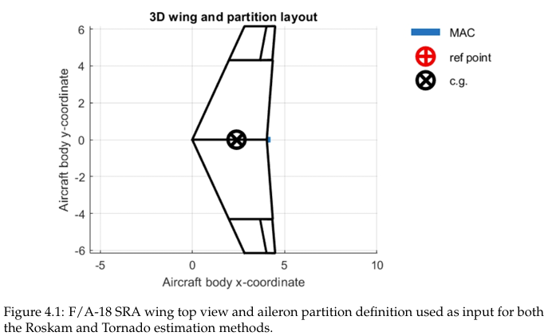
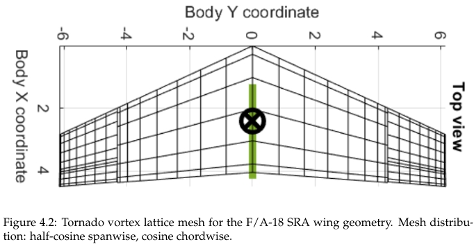
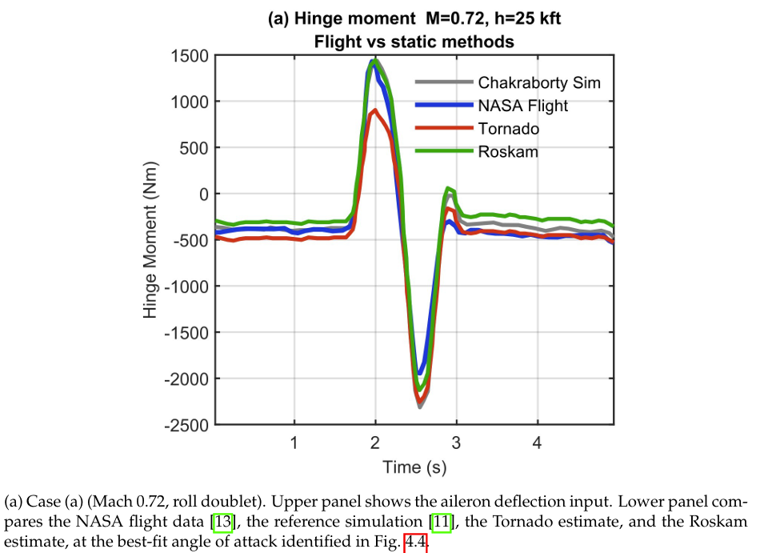
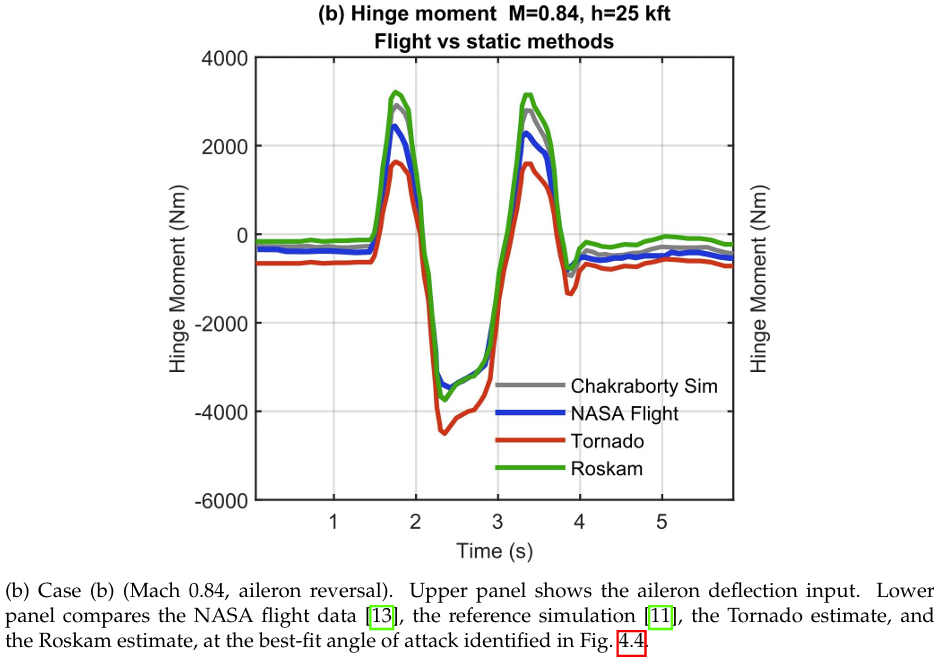
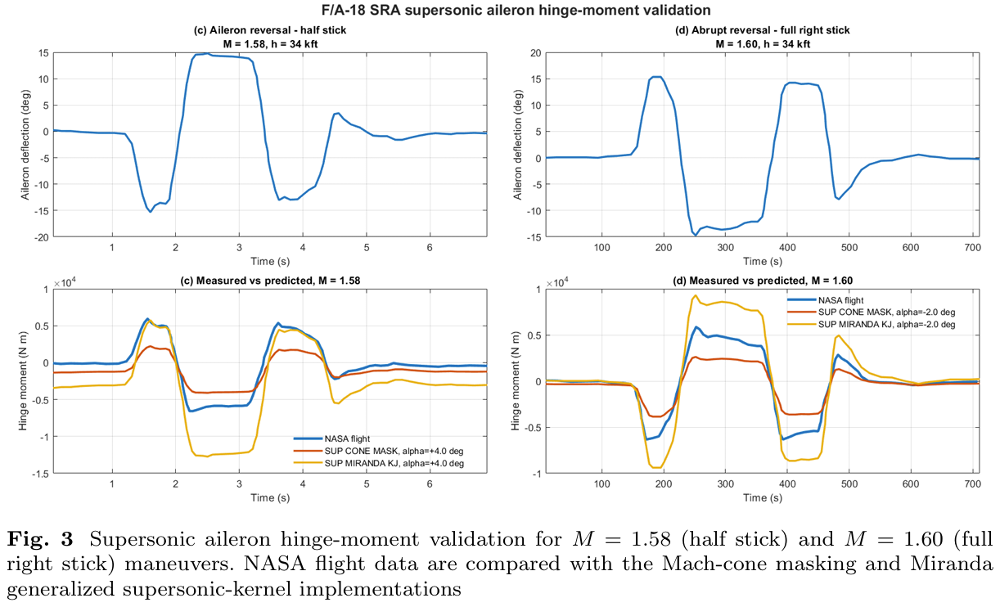

# Aircraft Aileron Hinge Moment Estimation

A MATLAB-based framework for preliminary estimation of aircraft aileron hinge moments, combining semi-empirical methods, vortex lattice aerodynamics and standardized aircraft geometry inputs.

## Overview

This repository contains the MATLAB code developed during my Master's thesis at Linköping University and its subsequent extension towards supersonic flight conditions.

The project focuses on the estimation of aileron hinge moments for aircraft conceptual design, supporting preliminary Flight Control System (FCS) sizing and actuator load assessment.

Two main implementations are included:

- **Thesis Implementation:** integration of Roskam's semi-empirical methodology and Tornado Vortex Lattice Method (VLM) within a common CPACS-based geometry framework.
- **Supersonic Extension:** an updated Tornado implementation based on Miranda's generalized supersonic vortex-lattice formulation, introducing a supersonic influence kernel and self-residual term.

## Methodology

The baseline framework combines three main components:

1. **Roskam Method:** automated implementation of the semi-empirical hinge moment estimation methodology, including digitization and interpolation of the relevant empirical charts.
2. **Tornado VLM:** aerodynamic force computation and integration of the control-surface panel loads about the aileron hinge axis.
3. **CPACS Interface:** standardized aircraft geometry definition, shared by both estimation methods.

### Aircraft Geometry and Aerodynamic Model

The framework was applied to the F/A-18 Systems Research Aircraft (SRA), using a common geometric definition for the Roskam and Tornado implementations.



*F/A-18 SRA wing planform and aileron partition used in the computational framework.*

The aerodynamic model is generated using Tornado's Vortex Lattice Method.



*Tornado VLM panel discretization of the wing and aileron.*

## Validation and Results

The baseline implementations were compared against NASA F/A-18 SRA flight-test data and reference simulation results from the literature.

The validation covered two subsonic flight conditions:

- Mach 0.72 – Roll doublet maneuver.
- Mach 0.84 – Aileron reversal maneuver.





*Comparison between NASA flight-test data, reference simulation, Roskam and Tornado hinge moment estimates.*

The results showed comparable performance between the two baseline methods under the investigated subsonic conditions, with increasing discrepancies as the transonic regime was approached.

## Supersonic Extension – Miranda Formulation

The original Roskam and Tornado implementations rely on a Prandtl–Glauert compressibility correction, which is not physically applicable beyond Mach 1.

To investigate an extension of the vortex-lattice approach to supersonic conditions, the Tornado implementation was modified using Miranda's generalized swept-horseshoe vortex formulation.

Two approaches were investigated:

- **Mach Cone Masking:** restriction of aerodynamic panel influence according to the supersonic domain of dependence.
- **Miranda Kernel with Self-Residual:** implementation of the generalized supersonic induced-velocity formulation, including its diagonal self-residual contribution.

The extended implementation was evaluated against NASA flight-test data for Mach 1.58 and Mach 1.60.



*Comparison of NASA flight-test data with the Mach-cone masking and Miranda generalized supersonic-kernel implementations.*

The Miranda-based implementation recovers the main dynamic response and the correct order of magnitude of the measured hinge moments. However, overprediction remains at large aileron deflections. The extension should therefore be considered preliminary, with further mesh-sensitivity studies and validation required.

## Repository Structure

```text
.
├── README.md
├── Documentation/
│   ├── Papers/
│   └── Figures/
├── Functions/
├── Inputs/
├── Roskam_Models/
├── CPACS_in/
├── TORNADO/
├── VALIDATION/
└── Supersonic_Correction/
```

The root directory contains the original thesis implementation. The `Supersonic_Correction/` directory contains the subsequent supersonic development.

## Technical Documentation

Additional documentation is available in the `02_Documentation/Papers/` directory:

- [Master's Thesis – Aileron Hinge Moment Estimation](02_Documentation/Papers/Masters_Thesis.pdf)
- [Supersonic Extension – Miranda Kernel Implementation](02_Documentation/Papers/Supersonic_Extension.pdf)

These documents provide the theoretical background, mathematical formulations, implementation details, validation procedures and extended results.

## Requirements

- MATLAB
- Tornado Vortex Lattice Method
- CPACS geometry input files and associated utilities

## Scope and Limitations

The framework is intended for preliminary aerodynamic load estimation and conceptual aircraft design.

The baseline methods have been evaluated against F/A-18 SRA reference data under selected subsonic conditions. The supersonic extension represents a preliminary implementation of a generalized vortex-lattice formulation and is not intended to replace higher-fidelity aerodynamic analyses.

## Author

**Andrea Vitale**
MSc Aeronautical Engineering – Linköping University

## Supervision and Contributions

**Erick Espinoza Juarez** - Thesis Supervisor
**Leone Tuci** - Supersonic Contribution 
